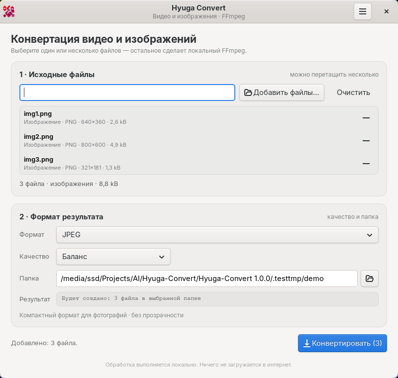

# Hyuga Convert

Небольшой конвертер видео и изображений для Linux с графическим интерфейсом.
Написан на C с GTK 3, кодированием занимается локальный FFmpeg. 
Видео всегда перекодируется, а не копируется потоком.
Коды возврата: `0` — успех, `1` — ошибка конвертации/входа, `2` — неверныеаргументы.

Проект рассчитан на Arch Linux и совместимые дистрибутивы



## Возможности

- пакетная конвертация нескольких изображений или нескольких видео за один запуск;
- добавление файлов через диалог с множественным выбором, ручной ввод пути
  или перетаскивание сразу нескольких файлов;
- список выбранных файлов с возможностью убрать отдельный файл или очистить всё;
- автоматическое определение типа файла, разрешения, длительности и размера;
- отдельные списки форматов для изображений и видео;
- анимированный GIF можно сохранить как видео или как отдельный кадр;
- три профиля качества;
- общий прогресс «Файл N из M», скорость кодирования, отмена и журнал FFmpeg;
- при ошибке одного файла пакет продолжает обрабатывать остальные;
- безопасные имена результатов: существующие файлы никогда не перезаписываются;
- кнопка «Открыть папку» после успешной конвертации;
- окно информации с версией, автором, сайтом, лицензией и полным текстом GPL;
- переключатель светлой и тёмной темы в окне информации — выбор запоминается;
- пункт «Импортировать в Hyuga Convert» в контекстном меню Nautilus;
- командный режим для скриптов;
- масштабирование HiDPI, Wayland/X11.

## Установка зависимостей (Arch Linux)

```bash
sudo pacman -S --needed base-devel gtk3 ffmpeg
```

- `gtk3` — интерфейс;
- `ffmpeg` — кодировщики и `ffprobe`;
- `glib2` (идёт вместе с GTK) — `glib-compile-resources` для сборки иконки и CSS;
- `librsvg` подтягивается как зависимость GTK и нужен для отрисовки SVG-иконки;
- `libnautilus-extension` — для пункта в контекстном меню Nautilus. На Arch
  устанавливается вместе с `nautilus`; если пакета нет, расширение просто не
  собирается, а сама программа работает.

## Сборка и запуск

```bash
make
./hyuga-convert
```

## Установка в систему

```bash
sudo make install
```

По умолчанию бинарник и данные ставятся в `/usr/local`:

- `/usr/local/bin/hyuga-convert`
- `/usr/local/share/applications/hyuga-convert.desktop`
- `/usr/local/share/icons/hicolor/scalable/apps/hyuga-convert.svg`


Для интеграции с Nautilus устанавливается расширение
`/usr/lib/nautilus/extensions-4/libhyuga-nautilus.so` (путь задаётся
`pkg-config` и не зависит от `PREFIX`, потому что Nautilus загружает расширения только из своего каталога модулей)

Удаление:

```bash
sudo make uninstall
```

Если нужна установка сразу в `/usr`:

```bash
sudo make PREFIX=/usr install
```

Можно использовать `DESTDIR` для упаковки в пакет:

```bash
make DESTDIR="$pkgdir" PREFIX=/usr install
```

## Поддерживаемые форматы

### Вход

| Тип | Форматы |
| --- | --- |
| Изображения | PNG, APNG, JPEG, WebP, BMP, TIFF, GIF, TGA, PNM (PPM/PGM/PBM) |
| Видео | MP4, M4V, MKV, WebM, AVI, MOV, MPEG/MPG/M2V, TS/MTS/M2TS, FLV, WMV, 3GP/3G2, OGV, VOB, ASF, F4V, GIF |

Тип определяется по расширению, MIME-типу, а для неизвестных расширений —
через `ffprobe`.

### Выход

| Формат | Кодеки / режим            | Особенности                                                 |
| ------ | ------------------------- | ----------------------------------------------------------- |
| PNG    | PNG, lossless             | Прозрачность сохраняется                                    |
| JPEG   | MJPEG, 4:4:4              | Без прозрачности, лучшее качество на фотографиях            |
| WebP   | libwebp                   | Прозрачность, хорошее сжатие                                |
| BMP    | BMP                       | Без сжатия, большой файл                                    |
| TIFF   | TIFF + Deflate            | Lossless, удобно для печати и архива                        |
| GIF    | GIF                       | Статичное изображение, 256 цветов                           |
| MP4    | H.264 + AAC, `+faststart` | Максимальная совместимость                                  |
| MKV    | H.264 + AAC               | Гибкий контейнер                                            |
| WebM   | VP9 + Opus                | Открытый современный формат                                 |
| AVI    | MPEG-4 + MP3              | Совместимость со старыми плеерами                           |
| MOV    | H.264 + AAC               | Формат экосистемы Apple                                     |
| GIF    | GIF-анимация              | Без звука, палитра 256 цветов, уменьшение до 720/480/360 px |

### Профили качества

| Профиль | H.264 | VP9 | JPEG | WebP | GIF |
| --- | --- | --- | --- | --- | --- |
| Высокое качество | CRF 19, preset slow | CRF 26, cpu-used 2 | q=2 | q=92 | 720 px, 15 fps |
| Баланс | CRF 23, preset medium | CRF 32, cpu-used 4 | q=4 | q=82 | 480 px, 12 fps |
| Малый размер | CRF 29, preset veryfast | CRF 38, cpu-used 5 | q=8 | q=68 | 360 px, 10 fps |

Звук: AAC 192/160/96 kbps, Opus 160/128/96 kbps, MP3 192/128/96 kbps.

## Командный режим

GUI не обязателен. Тот же backend доступен из терминала. CLI-режим обрабатывает
один файл за вызов; для пакета используйте графический интерфейс или Nautilus.

```bash
# список идентификаторов форматов
hyuga-convert --cli --list-formats

# видео MKV -> MP4, сбалансированное качество
hyuga-convert --cli -i video.mkv -f mp4 -q balanced

# изображение PNG -> WebP в указанный файл
hyuga-convert --cli -i image.png -f webp -o image.webp

# только показать команду FFmpeg
hyuga-convert --cli -i video.mov -f webm --dry-run
```

Параметры:

| Параметр               | Значение                                                                       |
| ---------------------- | ------------------------------------------------------------------------------ |
| `-i, --input FILE`     | Исходный файл (обязательно)                                                    |
| `-f, --format FORMAT`  | `png`, `jpg`, `webp`, `bmp`, `tiff`, `gif`, `mp4`, `mkv`, `webm`, `avi`, `mov` |
| `-o, --output FILE`    | Точный путь результата и название                                              |
| `-q, --quality PRESET` | `high`, `balanced` (по умолчанию), `small`                                     |
| `--list-formats`       | Показать входные и выходные форматы                                            |
| `--dry-run`            | Напечатать собранную команду FFmpeg и выйти                                    |
| `--version`            | Версия                                                                         |
| `--help`               | Справка по параметрам                                                          |

## Как это устроено

```text
src/main.c                     GTK3: окно, информация, тема, drag & drop, прогресс
src/media.c                    каталог форматов, ffprobe, сборка argv, имена файлов
src/media.h                    публичный интерфейс backend
src/input_formats.h            общий список входных расширений
src/nautilus/hyuga-nautilus.c  контекстное меню Nautilus
data/                          CSS, SVG-иконка, .desktop, GPL, GResource
tests/                         end-to-end smoke-тест через CLI
```

## Ограничения

- В одном пакете нельзя смешивать изображения и видео; GIF совместим с обеими группами.
- В GUI имя файла не редактируется — меняется только папка и формат.
- CLI-режим по-прежнему обрабатывает один файл за вызов.
- Пункт Nautilus показывается, когда выбраны только поддерживаемые файлы одного
  типа (изображения или видео; GIF можно добавлять к любой группе).
- Переносятся только первая видео- и первая аудиодорожка. Субтитры,
  дополнительные аудиодорожки и вложенные данные не сохраняются.
- Кодирование только на CPU: libx264, libvpx-vp9, libwebp, libopus и т. д.
  Аппаратные VA-API/NVENC не используются, чтобы не зависеть от драйверов.
- AVIF/HEIC как выходные форматы не включены: их наличие зависит от сборки
  FFmpeg и установленных энкодеров.
- Метаданные и главы обрабатываются средствами FFmpeg по умолчанию.
- Для очень больших файлов прогресс зависит от того, сообщает ли FFmpeg
  длительность; если длительность неизвестна, индикатор работает в режиме
  пульсации.

## Если что-то не работает

**«FFmpeg не найден»**
Установите пакет: `sudo pacman -S ffmpeg`, затем перезапустите Hyuga Convert.

**Ошибка `Unknown encoder 'libx264'` или `libvpx-vp9`**
Проверьте сборку FFmpeg:

```bash
ffmpeg -hide_banner -encoders | grep -E 'libx264|libvpx-vp9|libwebp|libopus'
```

Официальный пакет Arch включает эти энкодеры. Если FFmpeg собран вручную без
них, пересоберите его с нужными зависимостями.

**В консоли видны предупреждения `dconf-CRITICAL`**
Это ограничение конкретного sandbox/контейнера с read-only `$XDG_RUNTIME_DIR`,
а не ошибка Hyuga Convert. В обычном сеансе Arch предупреждений нет.

**Ошибка при конвертации**
Откройте «Журнал FFmpeg» под статусом — там будет полная команда и сообщение
кодировщика. GUI удаляет частично записанный файл, поэтому неудачный результат
не остаётся на диске.

**В Nautilus нет пункта «Импортировать в Hyuga Convert»**
Убедитесь, что установлен `nautilus` и расширение
`/usr/lib/nautilus/extensions-4/libhyuga-nautilus.so`, затем полностью
перезапустите Nautilus командой `nautilus -q`. Пункт появляется для выделенных
файлов с поддерживаемыми расширениями; нельзя смешивать изображения и видео.